<p align="center">
  <a href="https://git.io/typing-svg">
    
  </a>
</p>

<h3 align="center">ordinary people</h3>

<div align="center">
  
</div>

---

## 🚀 About Me

```js
const MySelf = {
  name: "Charles Marvin",
  location: "Tangsel, Indonesia",
  role: "Junior Developer",
  hobbies: "Learning frameworks and building things, Game, Turu, Repeat",
  funFact: "Coffee in, code out ☕⌨️"
};
```

- 🌱 Currently learning and deepening my skills in **React & Spring Boot**
- 👯 Looking to collaborate on **interesting web development projects**
- 💬 Ask me about **PHP, JavaScript, or anything related to web development**
- 📫 Reach me at: **charlesmarvin4321@gmail.com**
- ⚡ Fun fact: **I love exploring new technologies in Web**

---

## 🧠 Tech Stack

### ⚙️ Backend
<div align="left">
  
</div>

### 🗄️ Database
<div align="left">
  
</div>

### 🎨 Frontend
<div align="left">
  
  
</div>

### 🧩 UI Libraries
<div align="left">
  
  
  
  
</div>

### 📱 Mobile
<div align="left">
  
</div>

### 🛠️ Tools & DevOps
<div align="left">
  
</div>

### ☁️ Hosting
<div align="left">
  
</div>

### 🧰 Terminal & Shell
<div align="left">
  
</div>

### 💻 Operating Systems
<div align="left">
  
  
</div>

---

## 🌐 Connect With Me

<div align="left">
  <a href="https://instagram.com/carlsmrvn" target="_blank">
    
  </a>
  <a href="#" target="_blank">
    
  </a>
  <a href="mailto:charlesmarvin4321@gmail.com">
    
  </a>
</div>

---

## 📊 GitHub Stats

<p align="center">
  <a href="https://github.com/CarlesWebDev?tab=repositories">
    
  </a>
  
</p>

<p align="center">
  
</p>

### 🏆 GitHub Trophies
<div align="center">
  
</div>

---

## 🎧 Activity

<div align="center">
  <a href="https://open.spotify.com/user/31pz7ooans5rerj5gjnjxtjgchdi" target="_blank" rel="noopener noreferrer">
    
  </a>
</div>

<br />

<div align="center">
  <picture>
    <source srcset="pacman-contribution-graph-dark.svg">
    
  </picture>
</div>

<br />


</document_content>
