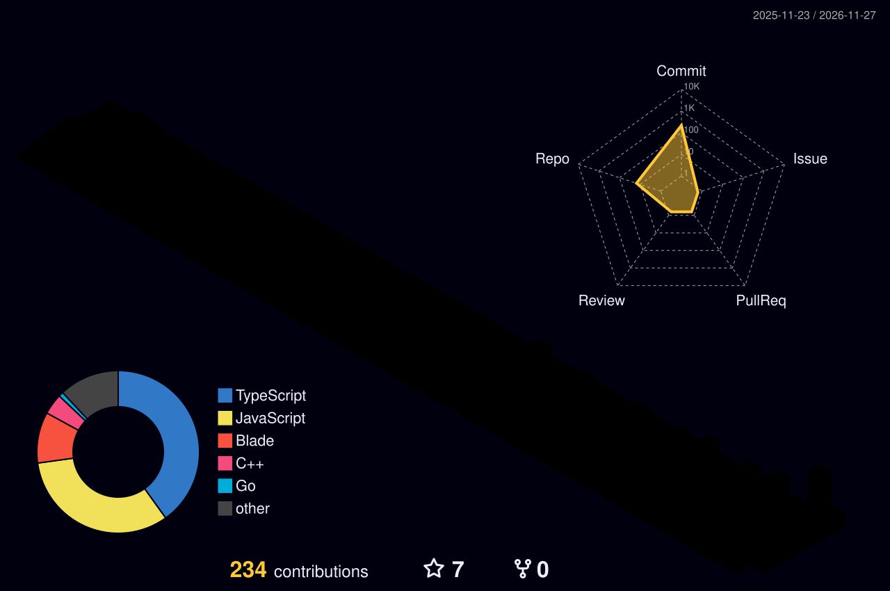

<div align="center">
  
</div>

<p align="center">
  <a href="https://git.io/typing-svg">
    
  </a>
</p>

<h3 align="center">ordinary people</h3>

<div align="center">
  
</div>


## 🚀 About Me

```js
const MySelf = {
  name: "Charles Marvin",
  location: "Tangsel, Indonesia",
  role: "Junior Developer",
  hobbies: "Learning frameworks and building things, Game, Turu, Repeat",
  funFact: "Coffee in, code out ☕⌨️"
};
```

- 🌱 Currently learning and deepening my skills in **React & Spring Boot**
- 👯 Looking to collaborate on **interesting web development projects**
- 💬 Ask me about **PHP, JavaScript, or anything related to web development**
- 📫 Reach me at: **charlesmarvin4321@gmail.com**
- ⚡ Fun fact: **I love exploring new technologies in Web**


## 📚 Currently Learning

<div align="center">
  
</div>


## 🧠 Tech Stack

<details open>
<summary><b>⚙️ Backend</b></summary>
<br />
<div align="left">
  
  
</div>
</details>

<details>
<summary><b>🗄️ Database</b></summary>
<br />
<div align="left">
  
</div>
</details>

<details open>
<summary><b>🎨 Frontend</b></summary>
<br />
<div align="left">
  
  
</div>
</details>

<details>
<summary><b>🧩 UI Libraries</b></summary>
<br />
<div align="left">
  
  
  
  
</div>
</details>

<details>
<summary><b>📱 Mobile</b></summary>
<br />
<div align="left">
  
</div>
</details>

<details>
<summary><b>🛠️ Tools & DevOps</b></summary>
<br />
<div align="left">
  
</div>
</details>

<details>
<summary><b>☁️ Hosting</b></summary>
<br />
<div align="left">
  
</div>
</details>

<details>
<summary><b>🧰 Terminal & Shell</b></summary>
<br />
<div align="left">
  
</div>
</details>

<details>
<summary><b>💻 Operating Systems</b></summary>
<br />
<div align="left">
  
  
</div>
</details>


## ⌨️ My Dev Setup

<div align="center">
  
</div>


## 🌐 Connect With Me

<div align="center">
  <a href="https://instagram.com/carlsmrvn" target="_blank">
    
  </a>
  &nbsp;
  <a href="https://www.linkedin.com/in/carlsmrvn" target="_blank">
    
  </a>
  &nbsp;
  <a href="mailto:charlesmarvin4321@gmail.com">
    
  </a>
  &nbsp;
  <a href="https://corelevdigital.web.id" target="_blank">
    
  </a>
</div>


## 📊 GitHub Stats

<p align="center">
  <a href="https://github.com/CarlesWebDev?tab=repositories">
    
  </a>
  
</p>

<div align="center">
  
</div>

### 📈 Contribution Graph
<div align="center">
  
</div>

### 🏆 GitHub Trophies
<div align="center">
  
</div>


## 🏙️ My Contribution City

<div align="center">
  
</div>


## 🎧 Activity

<div align="center">
  <a href="https://open.spotify.com/user/31pz7ooans5rerj5gjnjxtjgchdi" target="_blank" rel="noopener noreferrer">
    
  </a>
</div>

<br />

<div align="center">
  <picture>
    <source srcset="pacman-contribution-graph-dark.svg">
    
  </picture>
</div>

<br />


<br />

<p align="center">
  
</p>

<div align="center">
  
</div>
